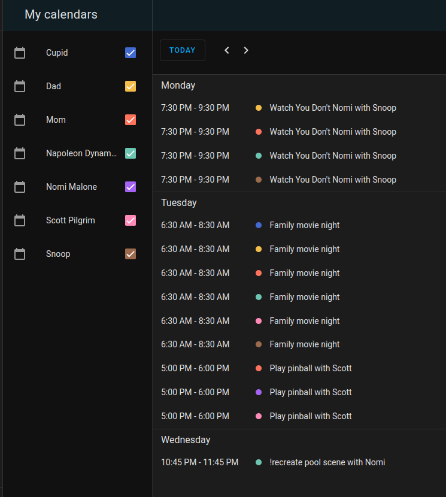

# family_calendar_sync

[Family Calendar Sync](https://github.com/McCroden/family_calendar_sync) is a custom component for Home Assistant that will sync `parent` calendars to `child` calendars. It also keeps the calendars in sync with the parent calendars.

The idea is to read from one or more `parent` calendar entities then copy the events to one or more `child` calendar entities. All of the events can be copied. Or just those that match a simple list of keywords.

**Which Calendar Integrations Work?**

- CalDAV:
    - Only works as `parent` because the integration doesn't have the ability to create an event.
- Google Calendar:
    - Works as both `parent` and `child` if it's set up with two-way sync permissions.
- Local Calendar:
    - Works as both `parent` and `child`.
- Remote Calendar:
    - Only works as `parent` because they are imported from remote.

## Background

I saw the Skylight calendar and thought it looked cool. But I didn't like that I'd have to use their app to attach the events to a child's calendars. My partner and I already have a good system in place. Our iCloud calendars are shared and we just manually put our kids' names in events that are relevant to them. I built this component to automate that process.

### Our Family's Process

I have an iCloud calendar and I Share it with my partner. My partner also has an iCloud calendar and Shares it with me. This is useful because if my partner adds an event titled "Dentist," I know there's a dentist appointment coming up.

When my partner or I create events for the kids we put their name in the event. I built this component to look for keywords (e.g. their name) and copy those events to their calendars. I put a couple of buttons on my Home Assistant dashboard to run the sync manually, but you can also set up an automation to run it on a schedule.

## Features

- Works for CalDAV (iCloud), Google Calendar, and Local Calendar entities
- Copy events from one calendar to another and keep them in sync (by using an automation)
- If an event is added to a `child` calendar, it will not be harmed by this service
- Specify how many days in the future to sync
- Ignore all events that start with a character you specify
- `child` calendars can have many keywords to match against (e.g. their name, "family", "kids", etc.)
- Only deletes a `child` event if Family Calendar Sync service created it **and** the event details no longer match the `parent`s event.

## Install

This component is installed via [HACS](https://hacs.xyz). 

### Method 1

1. Install HACS first
1. Click this button [](https://my.home-assistant.io/redirect/hacs_repository/?owner=mccroden&repository=family_calendar_sync)
1. Click **Download** in the lower-right corner. Or, in the upper-right, click **⁝** > **Download**
1. Restart Home Assistant

### Method 2
1. Install HACS first
1. Go to **HACS** > **⁝** > **Custom repositories** 
1. Add `McCroden/family_calendar_sync` and choose **Integration** then click **ADD**
1. Go back to the main HACS landing page and search `family calendar sync`
1. Click on it
1. Click **Download** in the lower-right corner. If the Download button isn't there: in the upper-right, click **⁝** > **Download**
1. Restart Home Assistant

### Configuration

This component is configured using your `configuration.yaml` file. It has three main sections: options, parent, and child.

#### `options`

Type: Map

- **Purpose**: Configure global settings for how calendar events are synchronized.
- Map keys:
    - `days_to_sync` (optional):
        - **Type**: Integer
        - **Description**: The number of days into the future for which events should be synchronized. Default, 7.
    - `days_to_sync_past` (optional):
        - **Type**: Integer
        - **Description**: The number of days into the past for which events should be synchronized. Default, 0.
    - `ignore_event_if_title_starts_with` (optional):
        - **Type**: String
        - **Description**: If an event title starts with this string, the event will be ignored during synchronization. Because sometimes the kids don't need to know everything going on 😉.

#### `parent`

Type: List

- **Purpose**: The source (or parent) calendars whose events will be used as the basis for synchronization.
- List items:
    - Each entry is a map containing:
        - `entity_id`:
            - **Type**: String
            - **Description**: The unique identifier of a parent calendar (e.g., `calendar.napoleon_dynamite`).

#### `child`

Type: List

- **Purpose**: Define the target (or child) calendars where synchronized events should be copied.
- List items:
    - Each entry is a map with the following properties:
        - `entity_id`:
            - **Type**: String
            - **Description**: The unique identifier of a child calendar (e.g., calendar.dad).
        - `copy_all_from (optional)`:
            - **Type**: List
            - **Description**: Specifies the parent calendar(s) from which to copy all events from. Contains:
                - `entity_id`:
                    - **Type**: String
                    - **Description**: The unique identifier of the parent calendar.
        - `keywords` (optional):
            - **Type**: List of Strings
            - **Description**: A list of keywords used as a case-insensitive search filter against the title's of `parent` events. If not specified, only events from calendars listed in `copy_all_from` will be synced. Default is an empty list.

### Example `configuration.yaml`

Let's say we have the following family structure:
  - Napoleon Dynamite (dad)
  - Nomi Malone (mom)
  - Snoop (child)
  - Scott Pilgrim (child)
  - Cupid (child)


Here's the example `configuration.yaml`:

```yaml
family_calendar_sync:
  options:
    days_to_sync: 7
    ignore_event_if_title_starts_with: '!'
  parent:
    - entity_id: calendar.napoleon_dynamite
    - entity_id: calendar.nomi_malone
  child:
    # We also created a Local Calendar entity for mom and dad, because the
    # kids like to see what mom and dad have going on in their day too.
    - entity_id: calendar.dad
      copy_all_from:
        - calendar.napoleon_dynamite
      keywords:
        - dad
        - napoleon
        - family
    - entity_id: calendar.mom
      copy_all_from:
        - calendar.nomi_malone
      keywords:
        - mom
        - nomi
        - family
    - entity_id: calendar.snoop
      keywords:
        - snoop
        - family
        - kids
        - kiddos
    - entity_id: calendar.scott_pilgrim
      keywords:
        - scott
        - family
        - kids
        - kiddos
    - entity_id: calendar.cupid
      keywords:
        - cupid
        - family
        - kids
        - kiddos
```

Here is what the synced calendar looks like:



### Service

The component creates a `family_calendar_sync` service. This is what you would use in an automation to have them stay in sync. In the automation, you can specify how frequently the sync occurs.

#### Example Automation

This can be setup using the visual editor, but here is the yaml for an automation that runs every 15 minutes:

```yaml
description: "Run family calendar sync"
mode: single
triggers:
  - trigger: time_pattern
    minutes: /15
actions:
  - action: family_calendar_sync.family_calendar_sync
    metadata: {}
    data: {}
```

## TODO

- [ ] Create tests for everything
- [ ] Add check if child calendar is CalDAV and raise error because Home Assistant cannot create events on CalDAV entity.
- [ ] See if we can run sync on any event change within the time period being synced (default 7 days).
- [ ] Test if keywords work with multiple word strings
- [ ] Create option to allow keywords to be case-sensitive match
- [ ] Add todo lists
- [ ] Error handle if a CalDAV or Google Calendar (without two way permissions) entity is used as a `child`

## Migration-copy_all_from

For the `child` section, we are changing the optional argument `copy_all_from` to be a type List instead of type Map. 

Prior:

```
  child:
    - entity_id: calendar.dad
      copy_all_from:
        entity_id: calendar.napoleon_dynamite
```

After:

```
  child:
    - entity_id: calendar.dad
      copy_all_from:
        - calendar.napoleon_dynamite
```
